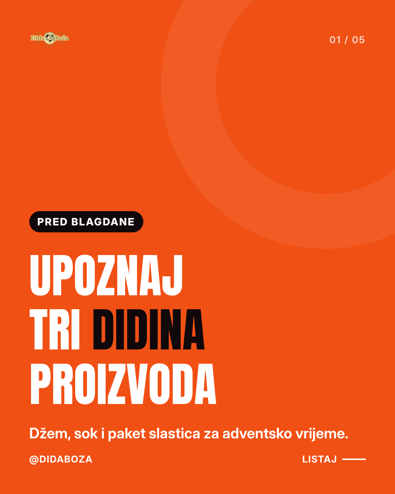
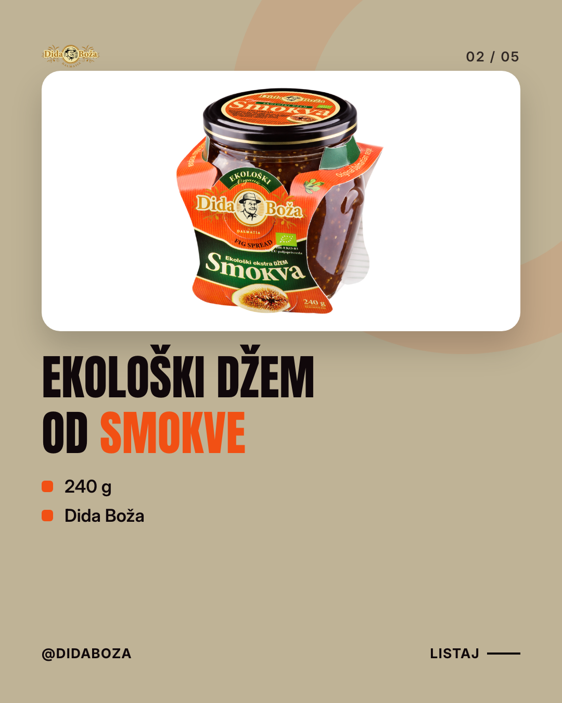
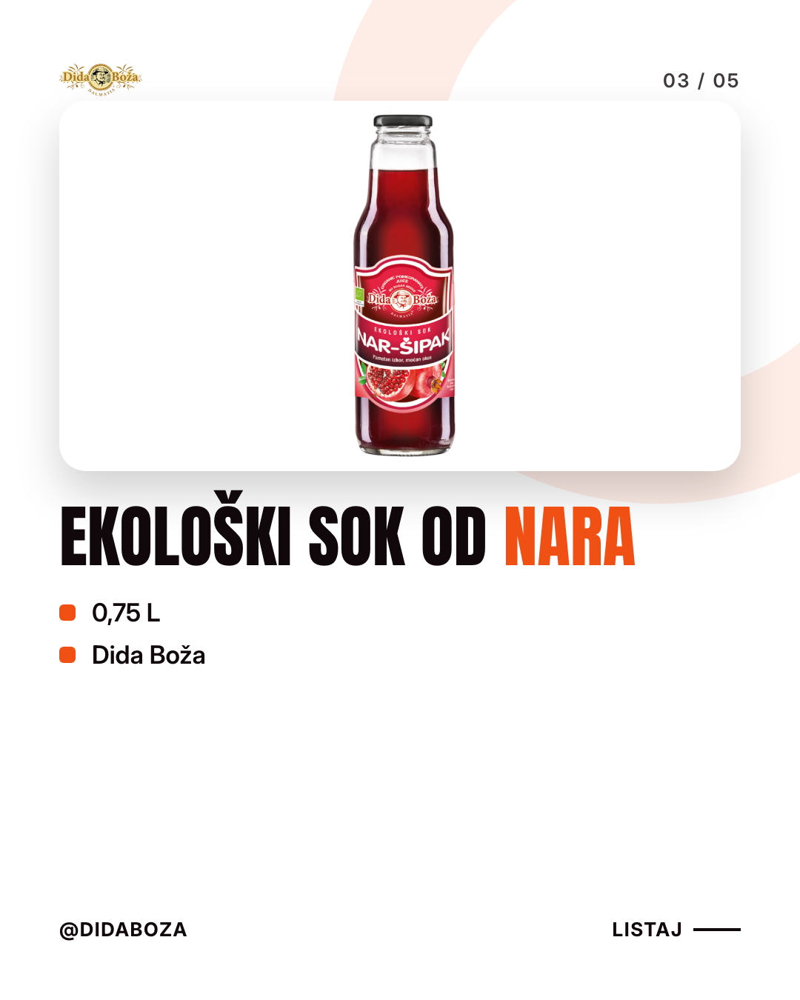
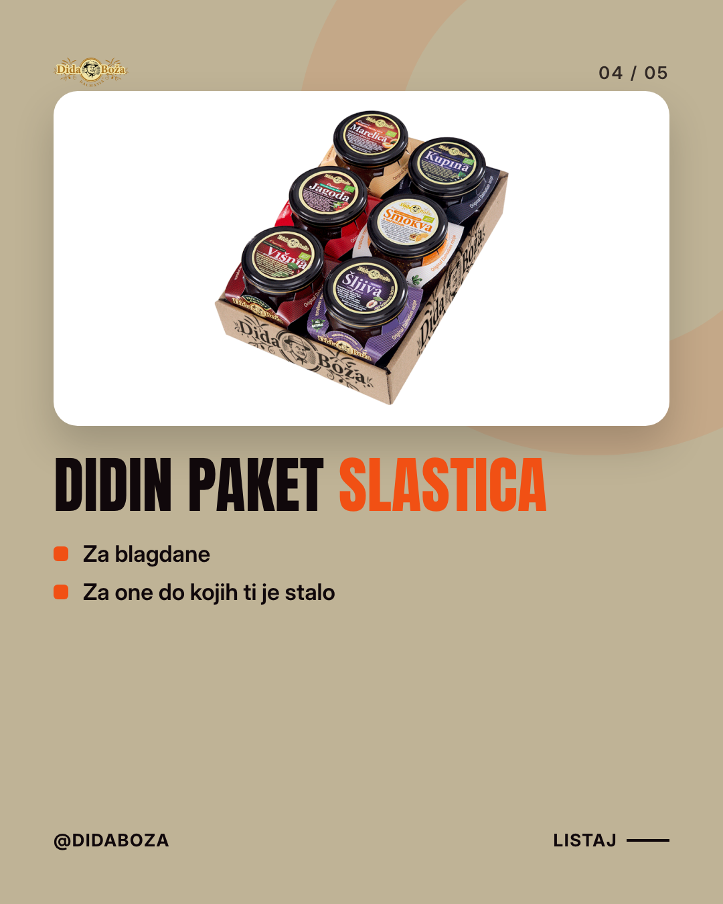
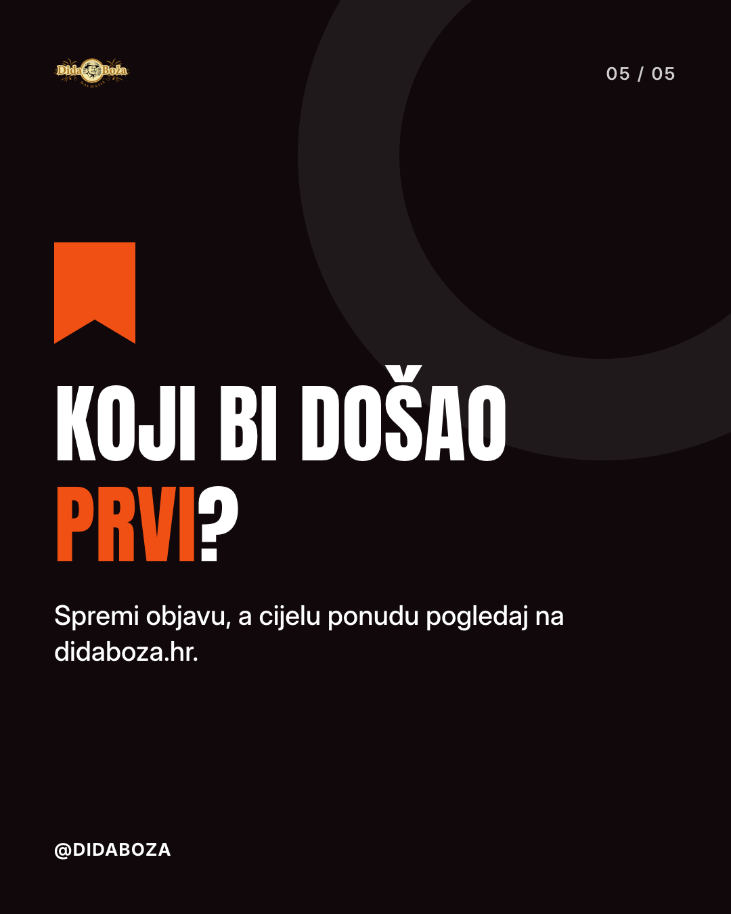

# Objava 1: Tri proizvoda za adventski stol

- **Format:** Karusel (feed, 1080×1350), 5 slajdova
- **Cilj:** Predstavljanje proizvoda
- **Proizvod:** Ekološki džem od smokve | 240 g - Dida Boža; Ekološki sok nar 0,75 L - Dida Boža; Didin paket slastica | Dida Boža - Dida Boža
- **KPI:** Omjer spremanja i dosega, uz broj klikova na poveznicu u biografiji prema webshopu.

## Koncept

Kratki karusel koji redom predstavlja tri proizvoda iz brifa, svaki na jednom slajdu s packshotom i punim nazivom. Cilj je da pratitelj zapamti imena proizvoda i spremi objavu za blagdanski izbor. Slajdovi nemaju tvrdnje o sastavu, okusu ni upotrebi. Nose ih samo naziv i toplo „ti” obraćanje.

## Zašto odgovara brendu

Brif kao prvi cilj navodi predstavljanje proizvoda (Brif: goals). Jedino što je provjereno su nazivi i kategorije proizvoda (S1, S2, S3), pa objava ostaje na njima. Ton je topao i s „ti”, prema Brif: tone_notes. Pozadine su bijele i bež, uz jedan narančasti naglasak, što slijedi izmjerenu paletu (pretpostavka). Postoji i sezonski okvir: kraj studenoga i advent.

## Opis objave

```
Blagdani su sve bliže, a mi ti predstavljamo tri imena koja vrijedi zapamtiti: ekološki džem od smokve (240 g), ekološki sok od nara (0,75 L) i Didin paket slastica. 🧡 Koji bi ti prvi došao na stol? Spremi objavu i napiši nam u komentaru, a cijelu ponudu pogledaj na didaboza.hr.

#DidaBoža #advent #blagdani #pokloniZaBlagdane #ekološkiProizvodi
```

## Alternativni tekst

Karusel s tri proizvoda marke Dida Boža: ekološki džem od smokve, ekološki sok od nara i Didin paket slastica.

## Upute za objavu

- Slajdove objavi redom (slajd_01 … slajd_NN).
- Opis kopiraj iz `opis.txt` bez izmjena.

## Slajdovi






