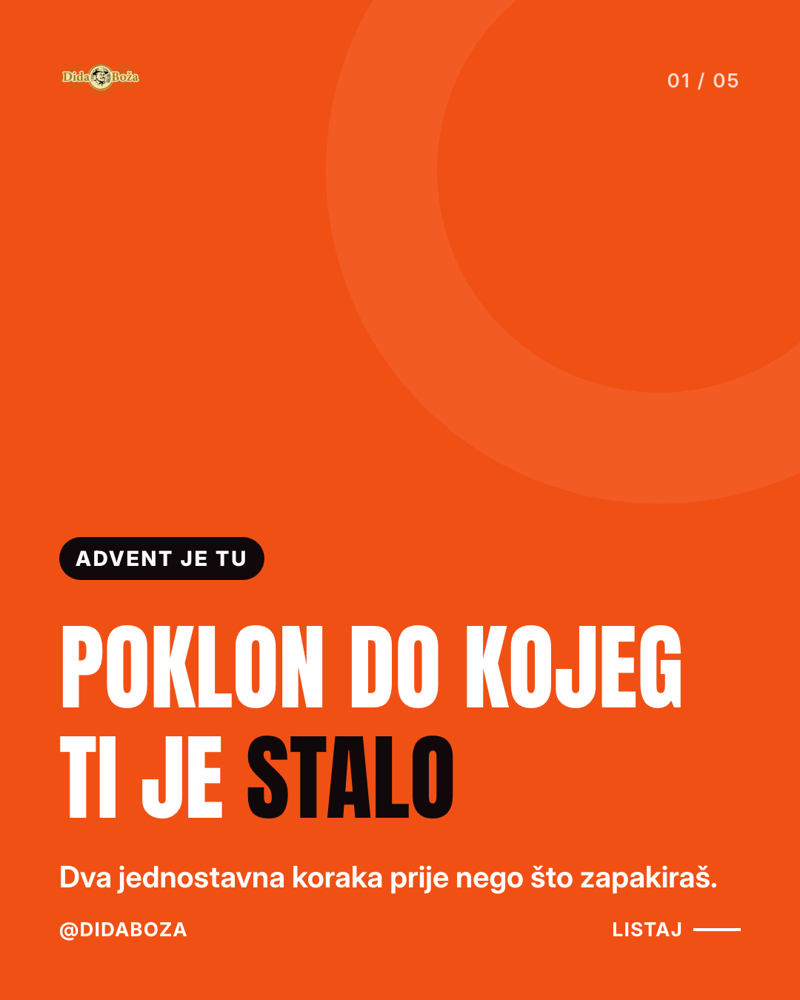
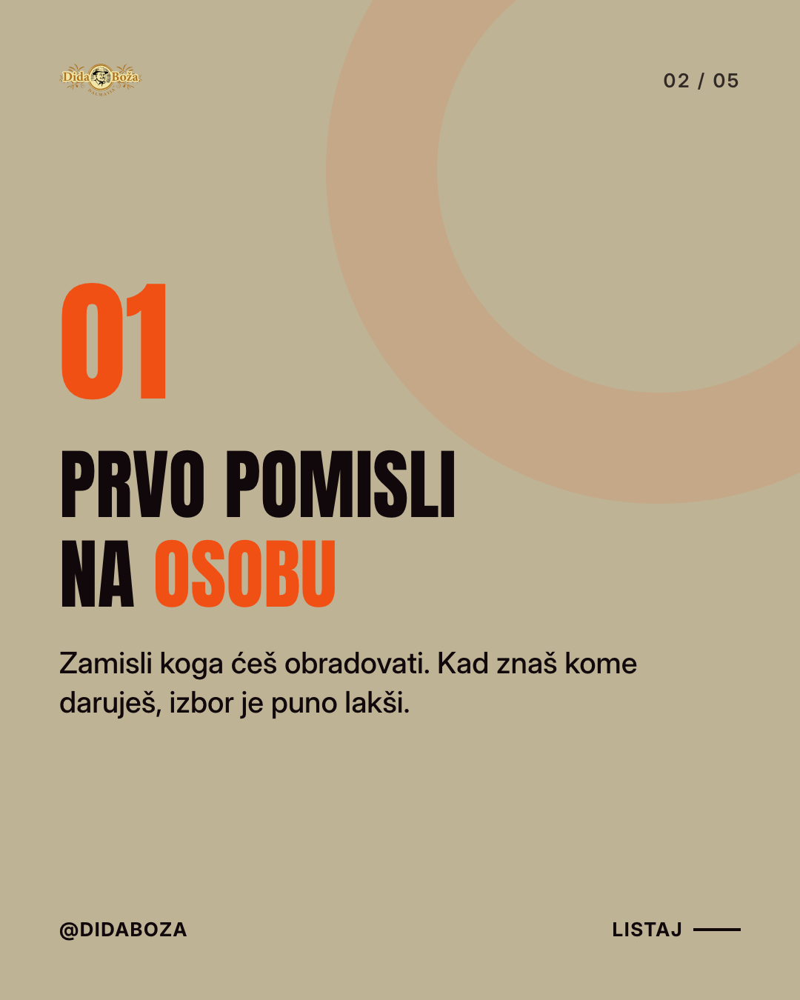
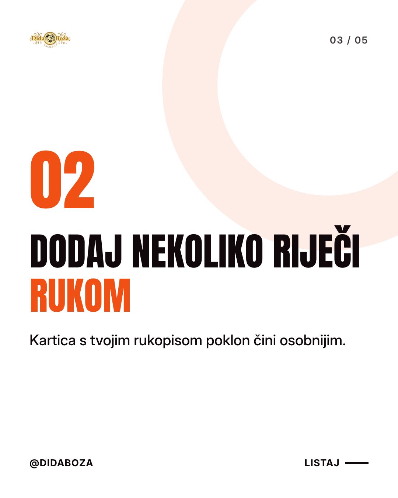
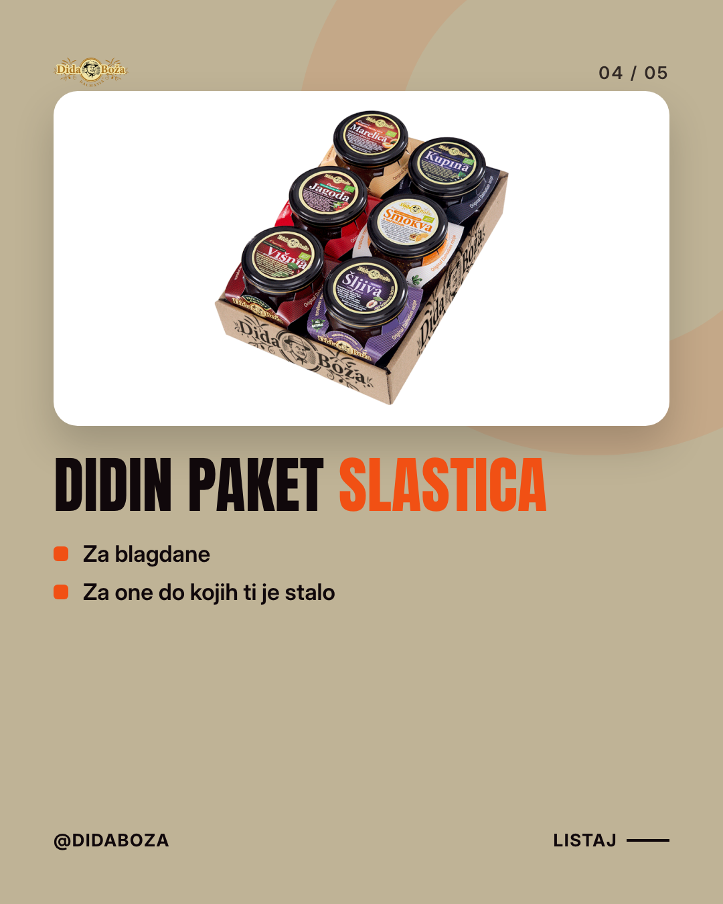
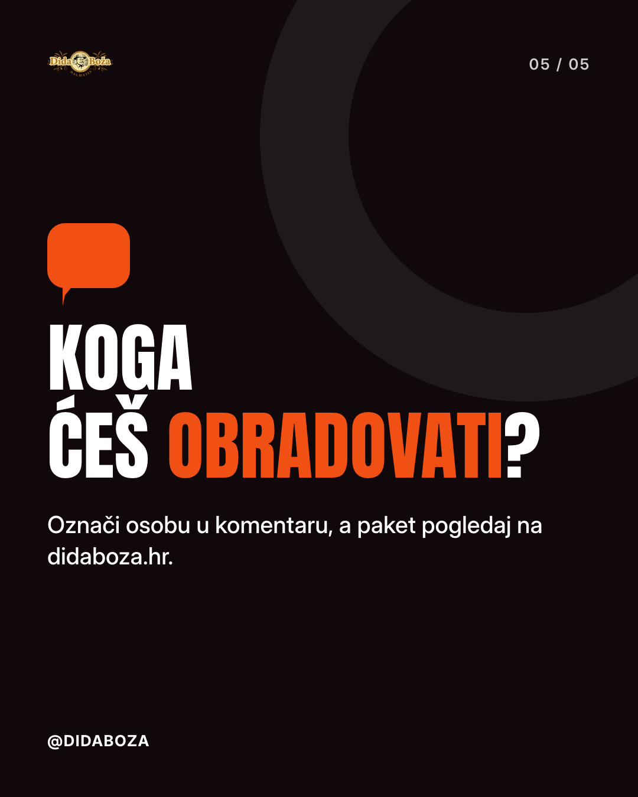

# Objava 2: Poklon do kojeg ti je stalo

- **Format:** Karusel (feed, 1080×1350), 5 slajdova
- **Cilj:** Interes za kupnju
- **Proizvod:** Didin paket slastica | Dida Boža - Dida Boža
- **KPI:** Broj spremanja i dijeljenja u porukama, te klikovi na poveznicu prema stranici paketa.

## Koncept

Karusel o darivanju u adventu. Prva tri slajda daju općenite, toplo napisane savjete koje se isplati spremiti: pomisli na osobu, dodaj ručno napisanu poruku, ne ostavljaj do zadnjeg trenutka. Zatim se kao jedno rješenje pokazuje Didin paket slastica, bez ijedne tvrdnje o sadržaju, a na kraju poziv na označavanje osobe.

## Zašto odgovara brendu

Drugi cilj iz brifa su blagdanski pokloni (Brif: goals). Analiza predlaže uokviriti poklon kao „za nekoga do koga ti je stalo” i ne obećavati sadržaj paketa dok se ne potvrdi sa stranice (Analiza: voice.do, S3). Savjeti o darivanju ne spominju svojstva proizvoda pa su sigurni, a ton je topao i u „ti” obliku. Sezona je advent.

## Opis objave

```
Advent je tu, a s njim i vrijeme za darivanje. Pomisli na osobu i dodaj nekoliko riječi napisanih rukom, a Didin paket slastica jedna je od ideja za one do kojih ti je stalo. 🎁 Označi osobu koju želiš obradovati i spremi objavu za kasnije.

#DidaBoža #pokloniZaBlagdane #advent #idejaZaPoklon #blagdanskiPoklon
```

## Alternativni tekst

Karusel o darivanju u adventu s dva savjeta i prijedlogom poklona: Didin paket slastica marke Dida Boža.

## Upute za objavu

- Slajdove objavi redom (slajd_01 … slajd_NN).
- Opis kopiraj iz `opis.txt` bez izmjena.

## Slajdovi






