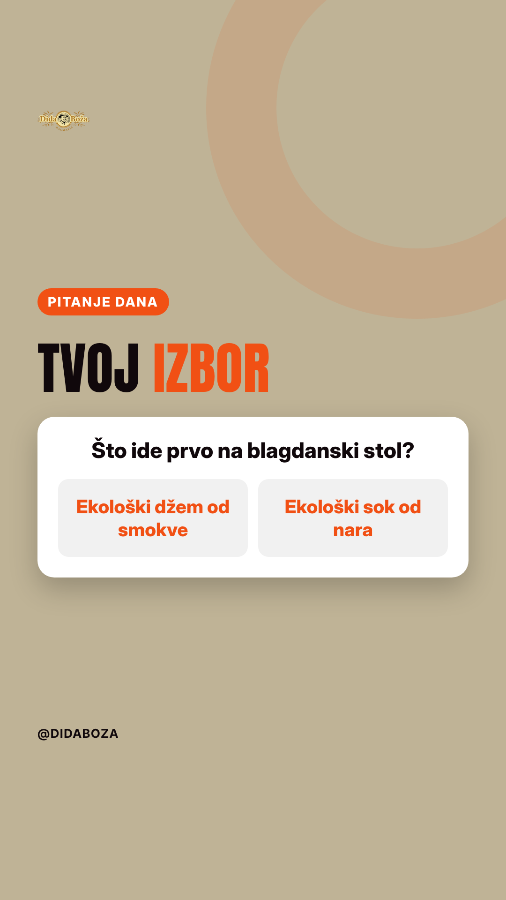
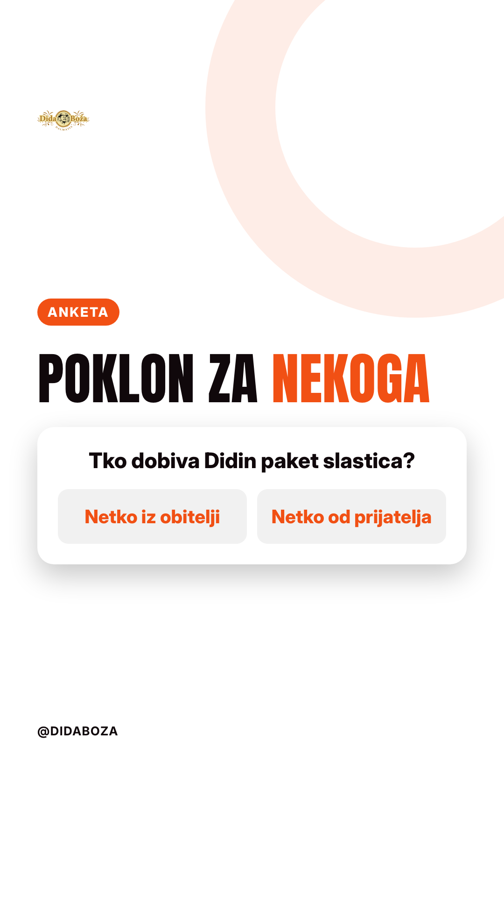
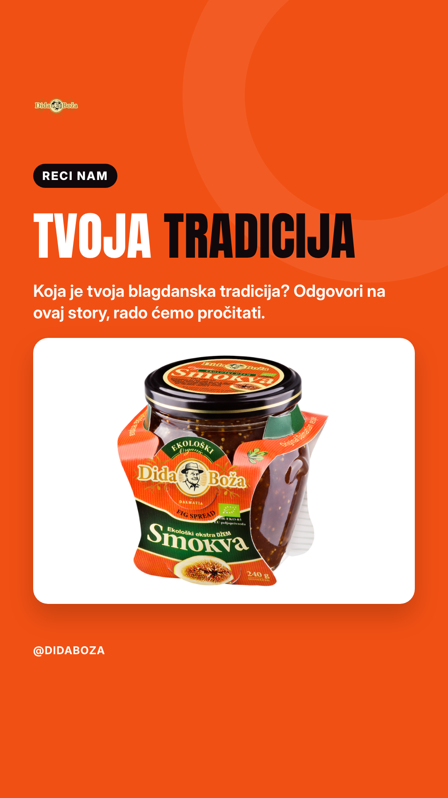
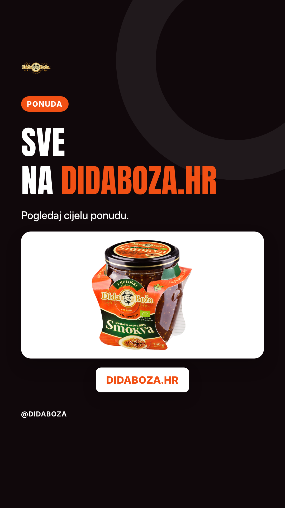

# Objava 3: Što prvo na blagdanski stol?

- **Format:** Niz storyja (1080×1920), 4 kadrova
- **Cilj:** Reakcije i komentari
- **Proizvod:** Ekološki džem od smokve | 240 g - Dida Boža; Ekološki sok nar 0,75 L - Dida Boža; Didin paket slastica | Dida Boža - Dida Boža
- **KPI:** Broj glasova u anketama i odgovora na pitanje, te udio gledatelja koji dođu do zadnjeg kadra i kliknu poveznicu.

## Koncept

Niz od četiri storyja za brze reakcije. Dvije ankete (džem ili sok; kome bi poklonio paket), otvoreno pitanje o blagdanskoj tradiciji uz odgovor u poruci te završna poveznica na webshop. Ankete ne traže nikakvu činjenicu o proizvodu, samo osobni izbor.

## Zašto odgovara brendu

Treći cilj iz brifa su reakcije i komentari, a analiza predlaže pitanja poput „kome bi poklonio paket” i CTA kao pitanje u „ti” obliku, a ne prodajni poziv (Analiza: opportunities, content_pillars). Storyji su lagan format za interakciju. Provjereni podaci o angažmanu ne postoje, pa je format prijedlog, a ne nalaz. Sezonski okvir je advent.

## Opis objave

```
Niz storyja: dvije ankete, pitanje o blagdanskoj tradiciji (odgovori stižu u poruke) i poveznica na didaboza.hr. Odgovore iz poruka ne objavljujemo bez dopuštenja.
```

## Alternativni tekst

Niz od četiri storyja: anketa o džemu ili soku, anketa o poklonu, pitanje o blagdanskoj tradiciji i poveznica na didaboza.hr.

## Upute za objavu

- Kadrove objavi redom kao story (kadar_01 … kadar_NN).
- Preko grafike ankete/kviza postavi nativne Instagram stikere (Poll / Quiz) s istim pitanjem i opcijama; grafika pokazuje njihov položaj.
- Na kadar s poveznicom postavi Link stiker (kratki poziv, npr. „Pogledaj proizvod”) s poveznicom na stranicu proizvoda.
- Nakon 24 h spremi niz u highlight (npr. „Članci”).

## Slajdovi





