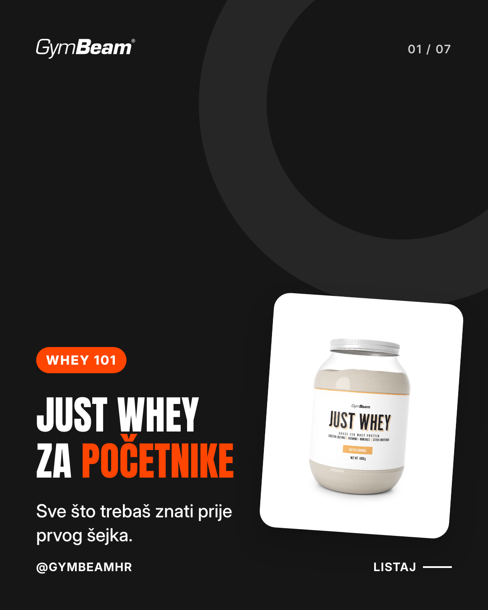
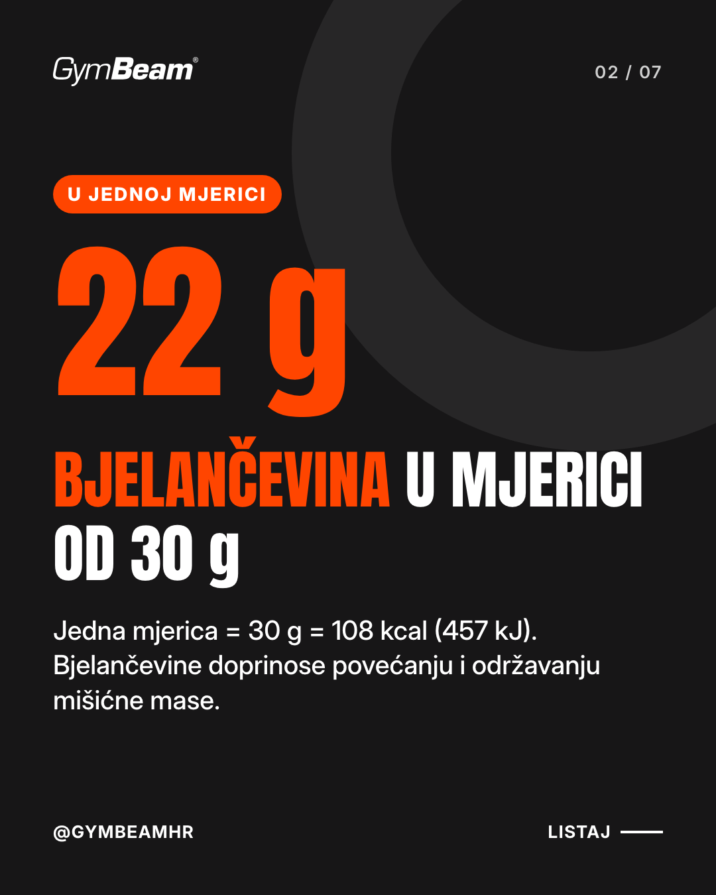
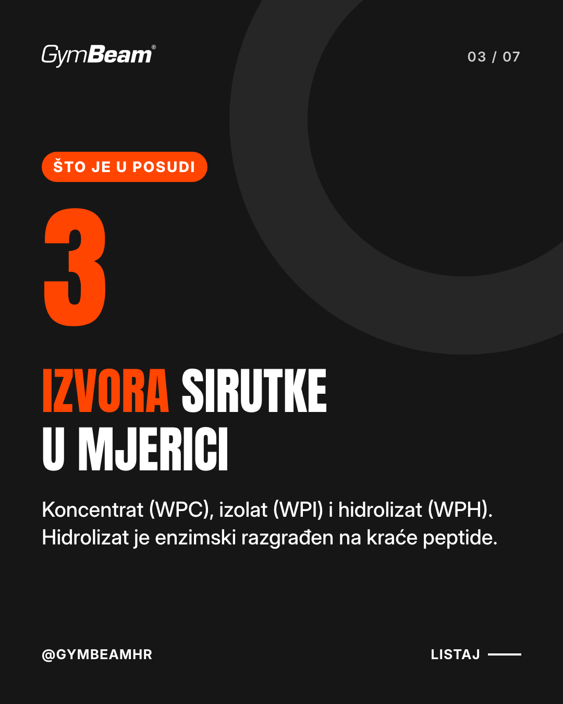
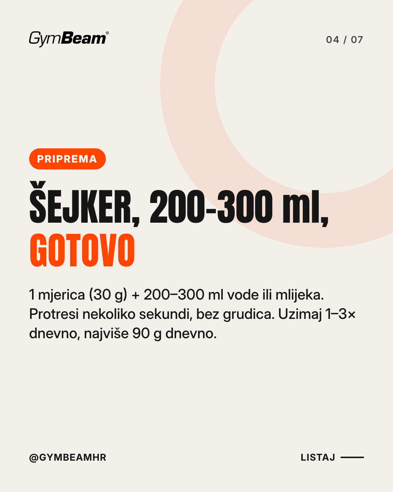
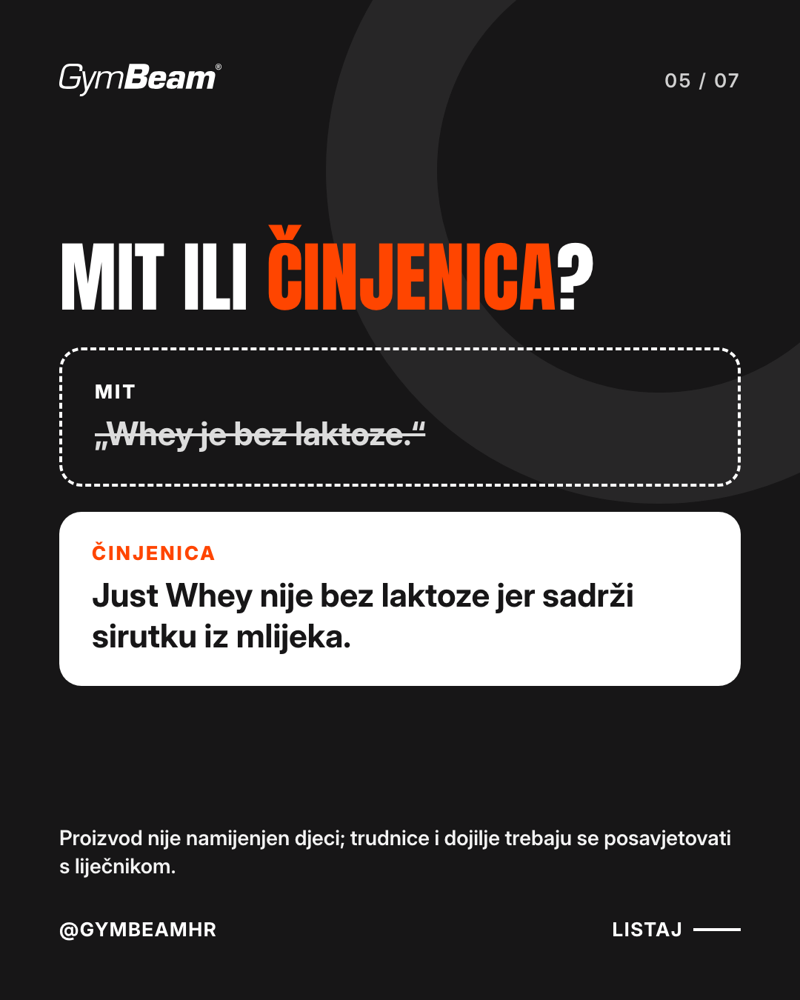
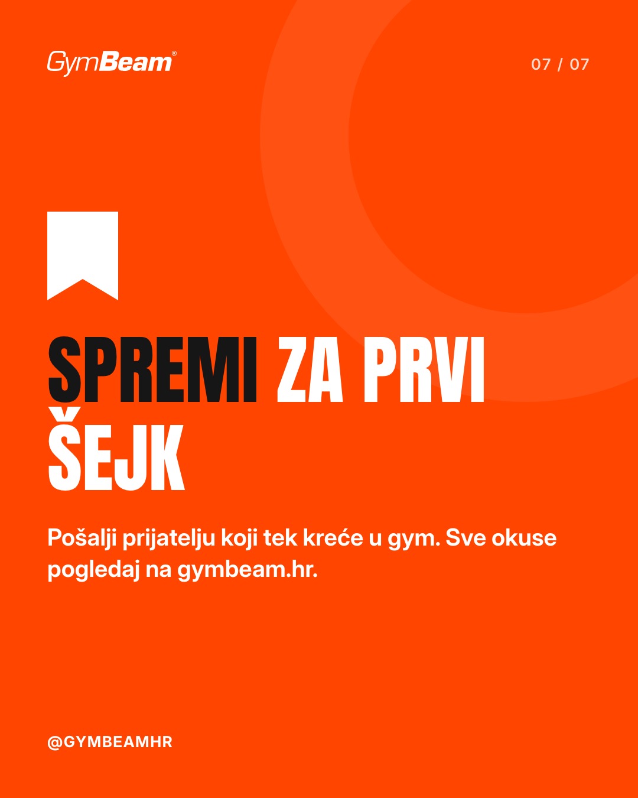

# Objava 1: Just Whey za početnike: 7 slajdova za spremanje

- **Format:** Karusel (feed, 1080×1350), 7 slajdova
- **Cilj:** Edukacija — spremanja
- **Proizvod:** Just Whey Grass-Fed Protein – GymBeam
- **KPI:** Glavni KPI je omjer spremanja i dosega, s ciljem iznad prosjeka profila za karusele (prvo mjerenje postaje referentna vrijednost, jer saves dosad nisu dostupni). Sporedni KPI su dijeljenja putem DM-a (poziv „pošalji prijatelju“) i postotak pratitelja koji dođu do 7. slajda.

## Koncept

Kratki vodič za nekoga tko tek kreće s proteinom. Pokriva što ima u mjerici, od čega je, kako ga pomiješati i koliko ga uzimati. Jedan mit razbija pitanje laktoze, a blagdanski slajd pokazuje Just Whey bez okusa u pečenju („Merry Fitmas“). Vizualno ga oblikujemo kao GymBeam poster: tamna mrežasta pozadina, oznaka „01 / 07“, jedna riječ u narančastoj #FF4500 i zadnji slajd „Spremi“.

## Zašto odgovara brendu

Analiza utvrđuje da na vidljivim objavama nema edukativnih karusela i da se Just Whey ne pojavljuje nigdje (analiza, teme; IG:01–IG:08). Kao prvu priliku navodi upravo „Just Whey u 5 slajdova“. Karusel je glavni format brenda (IG:02 ima 13 slajdova, IG:03–IG:05 po 5). Oznaka niza i poziv na listanje preuzeti su iz IG:02 („01 / 13“, „PRONAĐI SVOJ ZNAK →“), a ondje se već koristi i „ti“. Blagdanski slajd nastavlja „MERRY FITMAS / JINGLE ALL THE WHEY“ iz mreže profila. Publika iz brifa traži jednostavna objašnjenja, pa svaki slajd nosi jednu informaciju i brojke doslovno sa S1.

## Opis objave

```
Tek ulaziš u svijet gyma? Ovo su osnove u 7 slajdova 💪 Spremi objavu za prvi šejk i pošalji je prijatelju koji tek kreće. Koji okus ti je prvi na popisu? 👇

Just Whey nije bez laktoze i nije namijenjen djeci; trudnice i dojilje trebaju se posavjetovati s liječnikom.

#gymbeamhr #gbig #gbnutrition #gbfit
```

## Alternativni tekst

Karusel od sedam slajdova na tamnoj mrežastoj pozadini s naslovima u verzalu i jednom narančastom riječi, uz packshot prozirne posude Just Whey sa srebrnim poklopcem. Slajdovi objašnjavaju sadržaj mjerice, vrste sirutke, pripremu u šejkeru, laktozu i pečenje s verzijom bez okusa.

## Upute za objavu

- Slajdove objavi redom (slajd_01 … slajd_NN).
- Opis kopiraj iz `opis.txt` bez izmjena.

## Slajdovi








