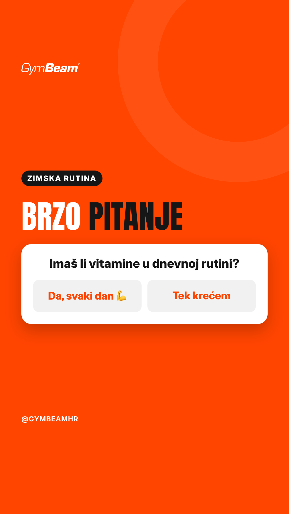
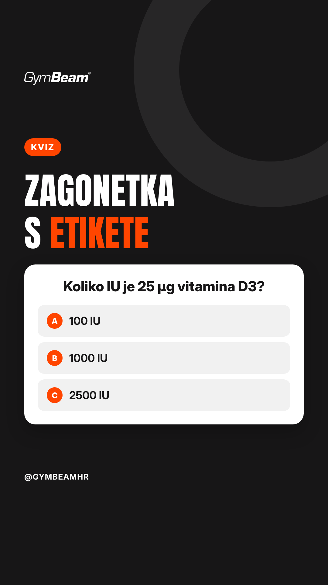
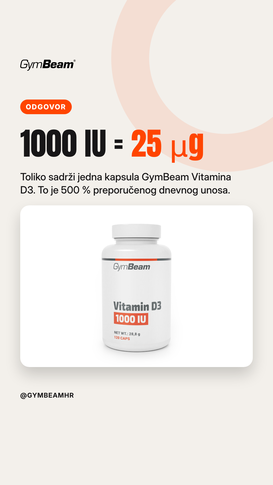
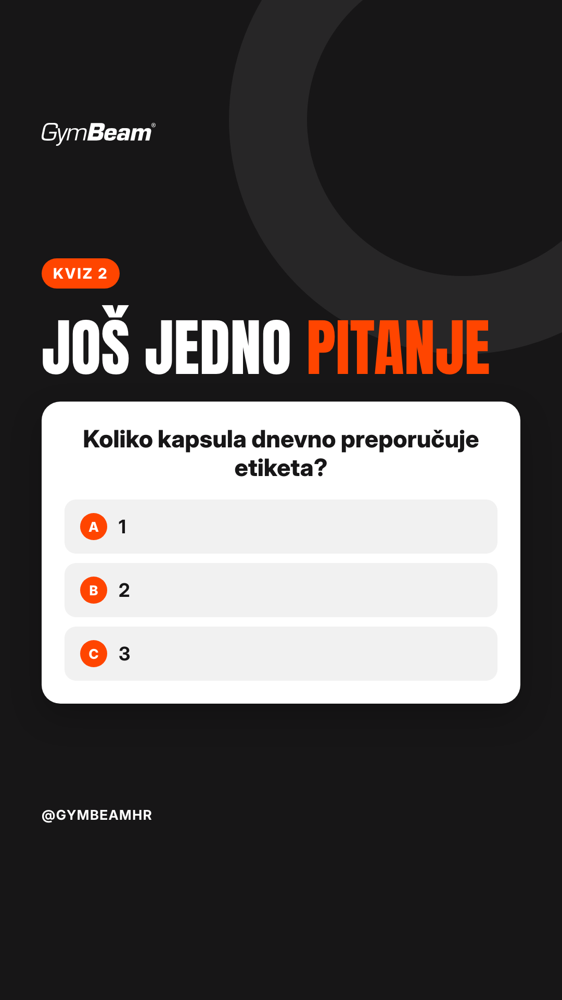
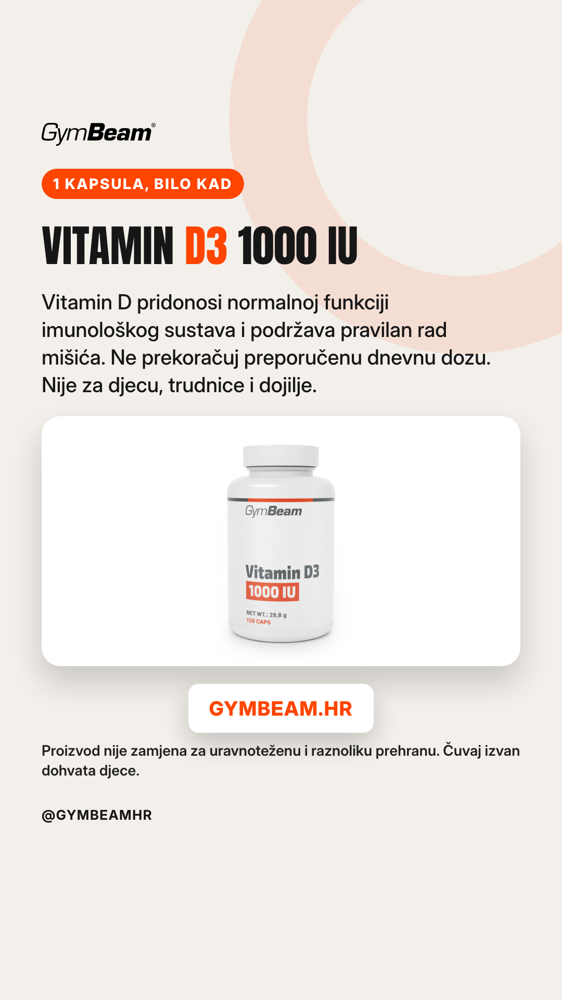

# Objava 3: Zimska rutina: D3 kviz u storyju

- **Format:** Niz storyja (1080×1920), 5 kadrova
- **Cilj:** Reakcije i komentari
- **Proizvod:** Vitamin D3 1000 IU - GymBeam
- **KPI:** Glavni KPI je stopa interakcije, odnosno broj glasova u anketi i kvizovima podijeljen s pregledima 1. kadra. Mjerimo i zadržavanje od 1. do 5. kadra (izlasci) te klikove na poveznicu u 5. kadru. Ovo je prvo mjerenje, jer metrike storyja dosad nisu bile dostupne.

## Koncept

Interaktivni niz od 5 kadrova za prosinac. Počinje anketom o vitaminima u dnevnoj rutini. Slijede kviz „Koliko IU je 25 μg?“, kadar s otkrivanjem točnog odgovora i packshotom te kviz o dnevnoj dozi. Završava se kadrom s poveznicom, odobrenim tvrdnjama i upozorenjima. Vizual prati vitaminski reel (IG:DgE5xBrHI5Z): topli drveni stol i ženska ruka, s bijelim bold tekstom pri vrhu kadra i narančastim #FF4500 stickerima.

## Zašto odgovara brendu

Analiza navodi da pitanja u opisima ostaju bez komentara (IG:01, IG:03, S6, S8). Kao priliku izravno predlaže interaktivne storyje, uključujući upravo kviz „Koliko IU je 25 μg?“. Vitamin D3 se dosad spominjao samo u opisu Black Friday reela (IG:DgE5xBrHI5Z), pa ovo je njegovo prvo samostalno predstavljanje. Wellness je postojeći stup sadržaja („Spakirajte sa mnom moje dnevne vitamine“), a format rutine pristaje zimskom razdoblju bez obećanja vezanih uz sezonu. Kviz s brojkama ujedno educira početnike o oznakama na etiketi.

## Opis objave

```
Story niz od 5 kadrova: anketa, dva kviza i poveznica „Pogledaj D3“ na stranicu proizvoda (varijanta s packshota). Na svakom kadru najviše jedan emoji. Nakon objave spremi niz u highlight „Članci“ ili „Novosti“. #gymbeamhr #gbhealthy
```

## Alternativni tekst

Niz storyja na toplom drvenom stolu sa ženskom rukom i bočicom GymBeam Vitamina D3 1000 IU, s bijelim podebljanim tekstom pri vrhu i narančastim stickerima za anketu i kviz. Zadnji kadar navodi dozu od jedne kapsule, odobrene tvrdnje i upozorenja te ima poveznicu „Pogledaj D3“.

## Upute za objavu

- Kadrove objavi redom kao story (kadar_01 … kadar_NN).
- Preko grafike ankete/kviza postavi nativne Instagram stikere (Poll / Quiz) s istim pitanjem i opcijama; grafika pokazuje njihov položaj.
- Na zadnji kadar postavi Link stiker s tekstom „Pogledaj D3” i poveznicom na stranicu proizvoda.
- Nakon 24 h spremi niz u highlight (npr. „Članci”).

## Slajdovi






